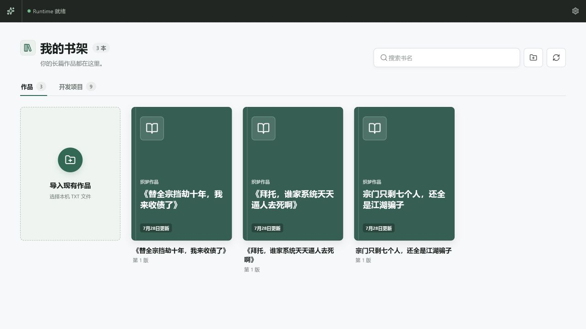
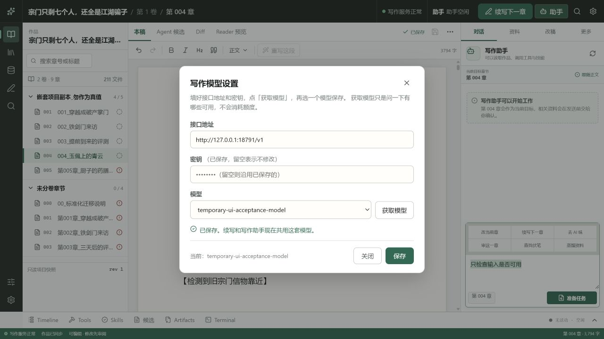
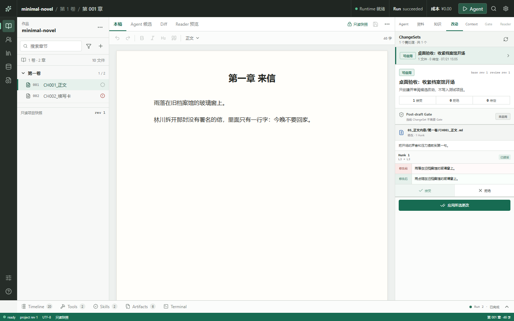

# Zhimeng Longform Studio

<p align="center">
  <strong>织梦长篇工作室：作者主导的本地长篇小说生产系统</strong>
</p>

<p align="center">
  书架管理 · 章节写作 · AI 续写与改稿 · Diff 审阅 · 本地落盘
</p>

<p align="center">
  
</p>

织梦长篇工作室不是自动替作者发布正文的“一键写书器”。它把模型生成、章节管理和人工审阅放进同一个本地工作台：模型先提出候选稿，作者看过差异并确认后，内容才会写回小说文件。

这是一个独立于 [织梦写作台](https://github.com/le5444/le5444.github.io) 的项目。织梦写作台面向通用 Agent 工作流；本仓库只聚焦长篇小说的持续创作、上下文管理和安全改稿。

## 目前能做什么

- 扫描本地小说目录，以书架形式管理多部作品和大量章节。
- 在界面内配置 OpenAI-compatible 接口地址、密钥和模型，并一键获取模型列表。
- 选择作品后“续写下一章”，生成待审阅的正文候选。
- 选中一段正文，填写要求后让模型重写这段。
- 在 Diff 中逐项接受或拒绝修改，确认后才写回磁盘。
- 写回前保留版本和备份，支持回滚已应用的改动。
- 自动读取章节控制卡，并在出稿后显示 AI 味检测结果。
- 导入本地 TXT/EPUB 资料，保留来源与处理状态。
- 通过 Writing Agent 读取项目文件、搜索内容并提出修改建议。

## 界面

### 在软件里配置模型

密钥只写入本机运行目录，读取接口不会返回密钥明文。



### 审阅后再写回

模型输出先进入候选和 Diff。作者可以逐段接受或拒绝；不点击应用，原小说文件不会改变。



## 快速开始

当前版本是 Windows 源码开发版，尚未发布可直接安装的 EXE。

### 环境要求

- Windows 10/11
- Python 3.12
- Node.js 20 或更新版本
- Git

### 安装

```powershell
git clone https://github.com/le5444/zhimeng-longform-studio.git
cd zhimeng-longform-studio

py -3.12 -m venv .venv
.\.venv\Scripts\python.exe -m pip install -e ".\services\writing-runtime[dev]"
npm install
```

### 启动

双击根目录的 `启动.cmd`。工作台就绪后会自动打开：

```text
http://127.0.0.1:5173
```

默认会扫描：

```text
%USERPROFILE%\Documents\写小说工作区
```

如需更换小说目录，在仓库根目录新建 `小说目录.txt`，文件中只写目标文件夹的绝对路径。完全退出时双击 `关闭.cmd`。

## 模型配置

推荐直接点击界面右上角的设置按钮，依次填写：

1. OpenAI-compatible 接口地址
2. API Key
3. 从接口获取或手动填写模型名
4. 保存

仓库仍保留 `本地模型配置.example.json`，仅供 `写一章.cmd` 命令行脚本使用。真实配置文件 `本地模型配置.json` 已被 Git 忽略。

## 工作方式


系统的核心边界是：模型可以读项目、搜索内容和提出修改，但不能绕过作者直接改写小说正文。

## 项目结构

```text
apps/workbench/               React + TypeScript 作者工作台
services/writing-runtime/     FastAPI + SQLite 本地运行时
packages/contracts/           前后端数据合同
adapters/builtin/             受管写作与知识能力适配器
desktop_packaging/            Windows 桌面打包代码
scripts/                      启动、停止和现场验收脚本
tests/                        跨模块测试
```

## 开发命令

```powershell
# 前端类型检查、测试与构建
npm run typecheck
npm run test:workbench
npm run build

# 后端测试
.\.venv\Scripts\python.exe -m pytest services\writing-runtime\tests
```

## 当前限制

- Windows EXE 和安装程序仍在制作，当前需要 Python 与 Node.js 开发环境。
- 四套小说 Skills 已有部分真实程序接入写作链，但完整的受管打包和跨机器运行仍未完成。
- `/models` 返回模型名不代表该模型一定能生成正文；实际可用性取决于接口供应方。
- 当前重点是作者本机使用，暂不提供云端账号、多人协作和在线同步。

## 数据与隐私

- 小说正文、运行数据库和模型密钥默认保存在本机。
- `.runtime/`、本地模型配置、聊天导出、真实验收数据和个人小说目录不会提交到 Git。
- 若使用第三方模型接口，发送给模型的章节上下文仍会经过该接口提供方。

## 项目状态

项目正在持续开发。书架、模型设置、续写下一章、选段重写、Diff 审阅和确认写回已经进入可运行链路；桌面安装包、完整 Skills 随包分发和更成熟的 Agent 编辑能力仍在推进。

## 许可

当前仓库未授予开源再分发许可。第三方依赖及仓库内标明来源的材料分别遵循其原许可证。
